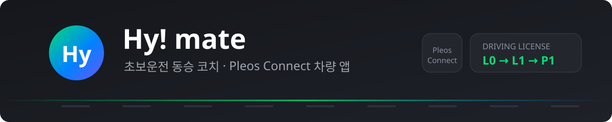
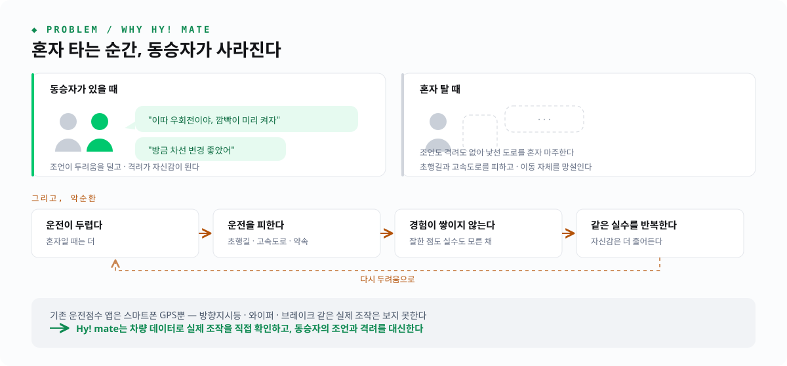
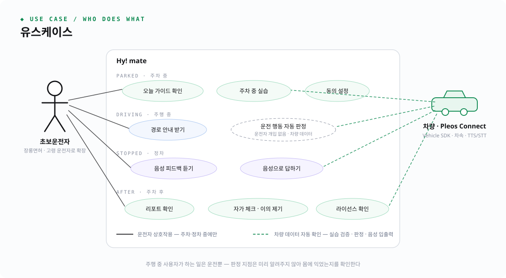
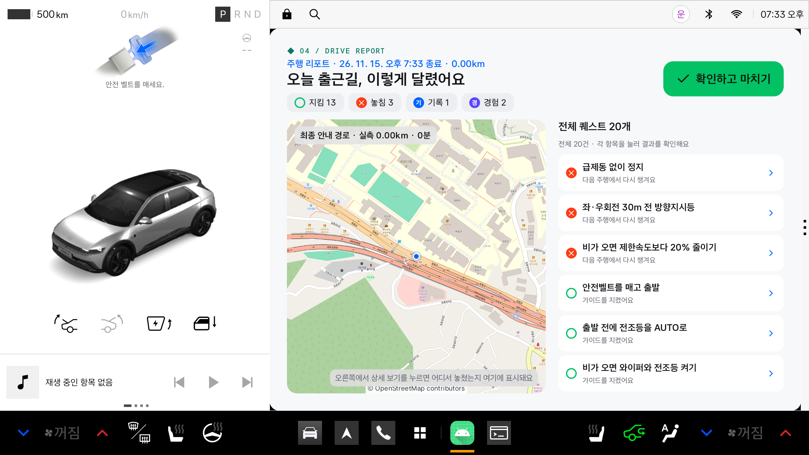
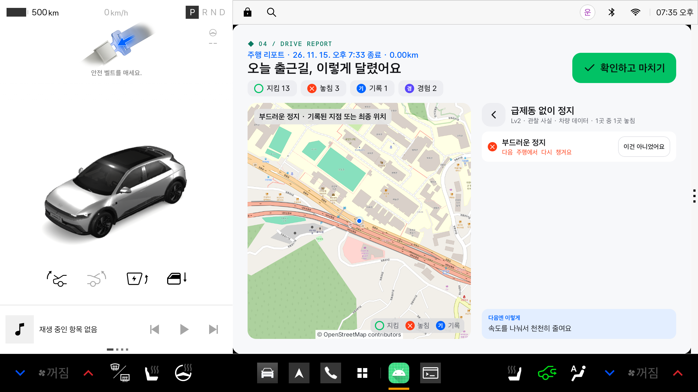
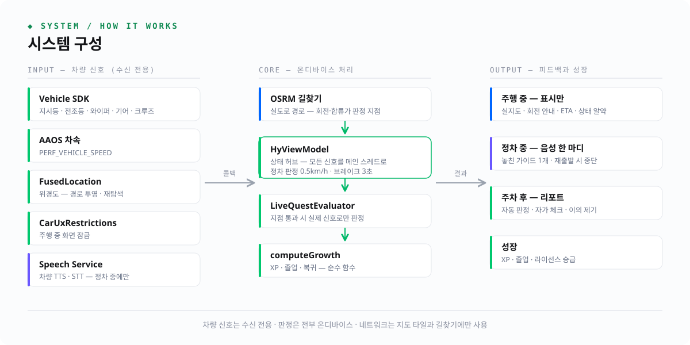
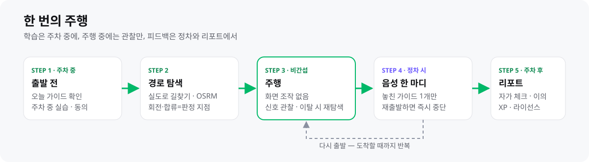

<p align="center">
  
</p>

# Hy! mate — 초보운전 동승 코치

> 혼자 타도 혼자가 아니게. 운전이 서툰 초보에게 **차가 직접** 좋은 습관을 가르쳐 주는 Pleos Connect 차량용 앱입니다.

<p align="center">
  
</p>

초보운전자는 옆자리에 봐 줄 사람이 없으면 내가 뭘 잘하고 뭘 놓치는지 알기 어렵습니다.
Hy! mate는 **주행 중에는 아무것도 요구하지 않고** 차량 데이터로만 조용히 관찰한 뒤,
**정차했을 때 한 마디**, **주차한 뒤 리포트**로 알려 줍니다. 잘한 것은 게임처럼 쌓여
라이선스(L0 → L1 → …)로 성장합니다.

---

## 왜 필요한가 — 문제 인식

<p align="center">
  
</p>

면허를 따고도 혼자 도로에 나서기 두려운 20~30대 초보운전자, 오랜 공백 끝에 다시 운전대를 잡기 망설이는 장롱면허 운전자가 핵심 타깃입니다(혼자 운전이 불안한 고령 운전자까지 확장).

이들이 기대는 것은 조수석의 **동승자**입니다. "이따 우회전이야, 깜빡이 미리 켜자" 같은 조언이 낯선 도로의 두려움을 덜어 주고, "방금 차선 변경 좋았어" 같은 격려가 자신감이 됩니다. 문제는 **혼자가 되는 순간 그 모든 것이 사라진다**는 것. 초행길과 고속도로를 피하게 되고, 운전을 마친 뒤에도 무엇을 잘했고 무엇을 놓쳤는지 알 길이 없으니 경험이 자신감으로 쌓이지 않습니다. 같은 실수를 반복하고, 두려움에 운전을 피하고, 그래서 경험을 쌓을 기회가 더 줄어드는 악순환입니다.

기존 모바일 내비게이션의 운전점수는 스마트폰 GPS로 과속·급가속 정도만 봅니다. **방향지시등을 언제 켰는지, 와이퍼와 전조등을 챙겼는지, 브레이크를 어떻게 밟았는지** — 운전 습관의 실체인 차량 조작은 보지 못합니다. Hy! mate가 차량에 탑재되어 차량 데이터에 직접 접근하는 이유입니다. 실제 조작에 근거해 피드백하고, 내 차에 있는 기능(오토 라이트·크루즈·음성 제어)을 배우게 해서, 동승자의 조언과 격려를 대신합니다.

## 주요 기능

| | |
|---|---|
| **출발 전 학습** | 오늘 경로·날씨·내 기록에 맞춰 챙길 가이드를 골라 주고, 주차 중에 레버·다이얼을 **실제로 조작**해 보며 손에 익힙니다 (Vehicle SDK로 즉시 확인) |
| **실도로 내비게이션** | OSRM 길찾기 + OpenStreetMap 지도. 회전·합류 지점이 그대로 **판정 지점**이 됩니다 |
| **비간섭 주행 판정** | 방향지시등·전조등·차속 등 실제 차량 신호로만 판정. 주행 중 화면 조작·알림 없음 |
| **정차 중 음성 한 마디** | 속도 0.5km/h 이하 + 브레이크 3초일 때만, 놓친 가이드 1개를 짧게 말해 줍니다 (차량 TTS/STT) |
| **정직한 리포트** | 차가 확인 못 한 항목은 추측하지 않고 운전자에게 직접 묻습니다(자가 체크). 이의 제기도 가능 |
| **성장과 라이선스** | 지킨 가이드는 XP로, 꾸준히 지키면 졸업으로. 누적되면 앱 안 라이선스가 승급됩니다 |
| **차종별 적응** | 차량 capability를 조회해 미지원 기능의 가이드는 자동 제외합니다 |

### 왜 이렇게 만들었나

**출발 전 학습** — 법규를 배웠어도 "오늘 내가 가는 길"에서 무엇을 주의해야 하는지는 떠올리기 어렵습니다. 그래서 목적지 경로·날씨·누적 기록으로 오늘 필요한 가이드만 선별하고(지난번 방향지시등을 늦게 켰고 지금 비가 온다면 그 둘부터), 각 항목에 근거 법령을 붙입니다. 버튼 위치가 낯설면 도로 위에서 조작을 망설이게 되므로, 주차 상태에서 레버·다이얼을 직접 만져 보고 차량 데이터로 즉시 확인합니다.

**실도로 내비게이션** — 판정이 설득력을 가지려면 가짜 시나리오가 아니라 실제 길의 실제 회전이어야 합니다. 경로 안내와 판정 지점을 같은 탐색 응답에서 만들기 때문에 "안내한 그 자리에서 본 그대로" 판정합니다. 경로를 벗어나면 자동 재탐색합니다.

**비간섭 주행 판정** — 주행 중 화면·음성 개입은 초보에게 가장 위험한 주의분산입니다. 그리고 판정 지점을 미리 알려주면 정답을 "따라 하게" 되어 몸에 익었는지 확인할 수 없습니다. 그래서 지점은 비공개로, 주행 중 앱은 침묵한 채 차량 신호만 기록합니다. 상황에 따라 정답이 달라지는 행동(비보호 좌회전 등)은 평가하지 않고 기록만 합니다.

**정차 중 음성 한 마디** — 피드백은 기억이 생생할 때 와야 교정이 되고, 많으면 소음이 됩니다. 완전히 멈췄을 때만(0.5km/h 이하·브레이크 3초) 직전 구간에서 놓친 것 중 중요한 **한 건**을 말하고, 같은 가이드는 주행당 한 번, 차가 움직이면 즉시 끊습니다.

**정직한 리포트** — 코칭은 신뢰가 전제입니다. 신호등 색처럼 차가 알 수 없는 것은 실패로 추측하지 않고 운전자에게 묻고(자가 체크), 판정이 실제와 다르면 "이건 아니었어요"로 성장 기록에서 제외할 수 있습니다. 모든 판정에 근거를 함께 보여줍니다.

**성장과 라이선스** — 나아진 것을 확인하지 못하면 경험이 자신감으로 이어지지 않습니다. 지킨 가이드는 XP로 쌓이고, 기준을 채우면 '졸업'해 더는 잔소리하지 않습니다(판정은 계속, 다시 놓치면 복습으로 복귀). 누적 XP는 L0→L1→… 라이선스로 가시화되어 "다시 혼자 타 볼 용기"가 됩니다.

**차종별 적응** — 내 차에 없는 기능을 안내하면 신뢰가 깨집니다. 연결 시 차량 capability를 조회해 미지원 기능의 가이드는 목록과 퀘스트에서 아예 제외합니다.

## 사용 시나리오

<p align="center">
  
</p>

## 화면

화면별 자세한 설명은 [`docs/images/README.md`](docs/images/README.md)에 있습니다.

| 홈 | 출발 전 가이드 | 가이드 상세 |
|---|---|---|
|  |  |  |

| 주차 중 실습 | 주행 (실지도 안내) | 정차 중 음성 피드백 |
|---|---|---|
|  |  |  |

| 주행 리포트 | 리포트 상세 · 이의 제기 | 라이선스 발급 |
|---|---|---|
|  |  |  |

| 동승 설정 (동의·음성 테스트) | 테스트 환경 (Pleos Virtual Console) |
|---|---|
|  |  |

## 어떻게 동작하나

<p align="center">
  
</p>

<p align="center">
  
</p>

## 기술 스택

| 영역 | |
|---|---|
| 플랫폼 |     |
| 차량 연동 |     |
| 지도 · 길찾기 |     |
| 테스트 |   |

## 실행 방법

1. **Pleos Connect Emulator**(v2.1.0+)를 실행합니다. 일반 폰/태블릿에서도 설치는 되지만 차량 신호 없이 UI만 동작합니다.
2. 프로젝트를 열고 `Run` — 길찾기·지도에 인터넷이 필요합니다.
3. **Virtual Console**(`adb forward tcp:8088 tcp:8088` → `http://127.0.0.1:8088/`)에서 기어·속도·방향지시등(Convenience 도메인)·와이퍼 등을 조작하면 앱이 실시간으로 반응합니다.
4. 위치 모드는 **동승 설정**에서 선택합니다.
   - `국민대 출발 데모`(에뮬레이터 기본): 위치 조작 없이 차속만으로 탐색된 실도로를 따라 이동
   - `실제 GPS`(실차 기본): 현재 위치에서 탐색, 60m 이상 이탈 시 자동 재탐색

자세한 지도·재탐색 테스트 시나리오는 [`docs/map-testing.md`](docs/map-testing.md)에 있습니다.

## 프로젝트 구조

```
app/src/main/java/com/example/hymate/
├── data/         도메인 모델 · 가이드 정의 · 성장 규칙        → data/README.md
├── navigation/   OSRM 길찾기 · 경로 투영 · 재탐색             → navigation/README.md
├── speech/       차량 TTS/STT · 음성 동의 대화                → speech/README.md
├── vehicle/      차량 데이터 소스 · 주행 세션 · 퀘스트 판정    → vehicle/README.md
├── ui/           Compose 화면 · 실지도 컴포넌트 · 테마         → ui/README.md
├── HyViewModel.kt   화면 상태와 주행 흐름을 잇는 허브
└── MainActivity.kt  데이터 소스 수명주기 · 권한 요청
```

## 설계 원칙

- **주행 중 비간섭** — 주행 중에는 화면을 쓰지 않습니다. `distractionOptimized` 선언과 함께 시스템 CarUxRestrictions를 받아 설정·연습·리포트를 스스로 잠급니다.
- **추측하지 않는 판정** — 신호가 안 들어온 항목은 실패로 만들지 않고 "직접 확인"으로 넘깁니다. 신호 색처럼 차가 알 수 없는 것은 운전자에게 묻습니다.
- **동의는 필요한 순간에** — 상황 가이드는 비가 올 때만 묻고, 모호한 대답·침묵은 절대 동의로 처리하지 않습니다.
- **데이터는 차 안에** — 판정은 전부 온디바이스로 처리하며 주행 궤적을 외부로 보내지 않습니다. 네트워크는 지도 타일과 경로 탐색에만 사용합니다.

## 외부 서비스 고지

지도 타일은 OpenStreetMap(© OpenStreetMap contributors), 길찾기는 OSRM 공개 데모 서버를 사용합니다.
두 서비스 모두 데모·개발 용도의 공용 인프라로, 요청 간격 제한·식별 User-Agent·디스크 캐시로 사용 정책을 지키고 있습니다.
상용 배포 시에는 상용 타일/라우팅 제공자로 교체가 필요합니다.
