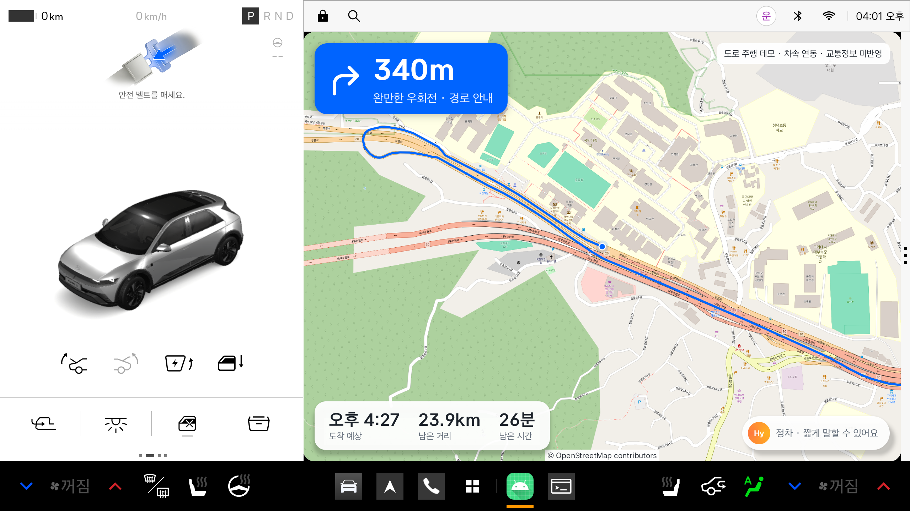
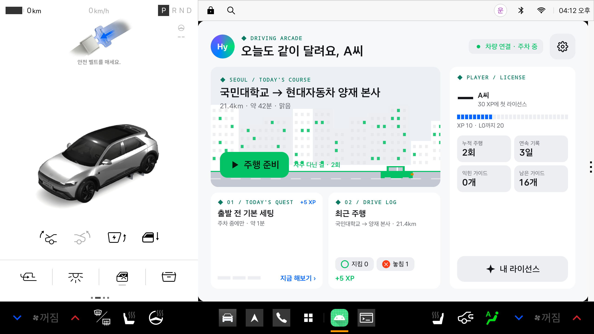
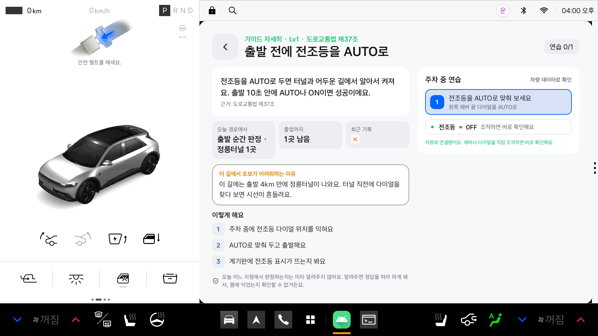
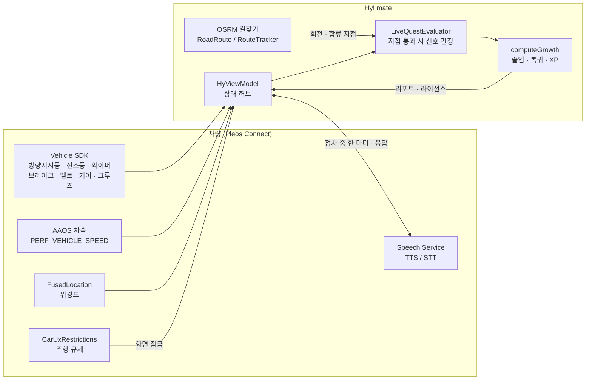
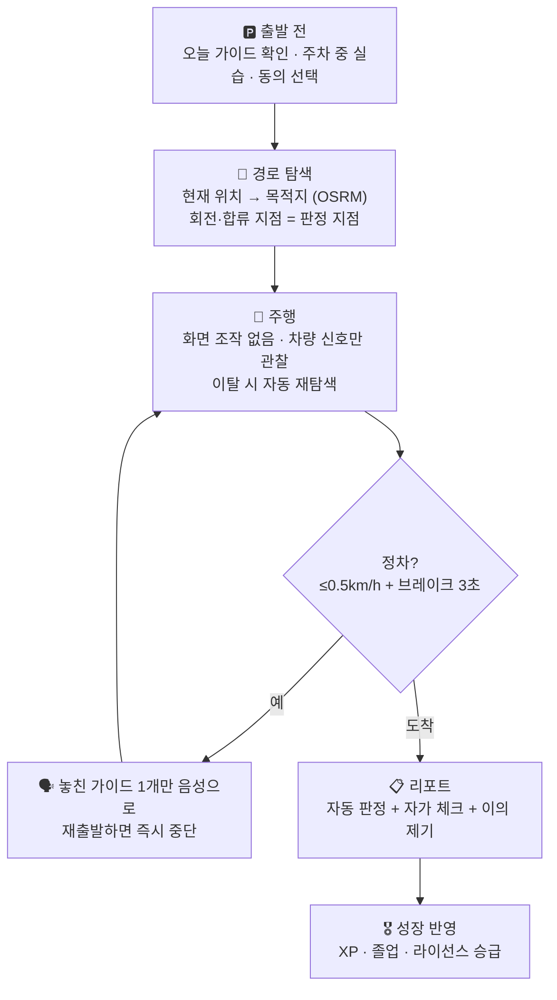

# Hy! mate — 초보운전 동승 코치

> 혼자 타도 혼자가 아니게. 운전이 서툰 초보에게 **차가 직접** 좋은 습관을 가르쳐 주는 Pleos Connect 차량용 앱입니다.

<p align="center">
  
</p>

초보운전자는 옆자리에 봐 줄 사람이 없으면 내가 뭘 잘하고 뭘 놓치는지 알기 어렵습니다.
Hy! mate는 **주행 중에는 아무것도 요구하지 않고** 차량 데이터로만 조용히 관찰한 뒤,
**정차했을 때 한 마디**, **주차한 뒤 리포트**로 알려 줍니다. 잘한 것은 게임처럼 쌓여
라이선스(L0 → L1 → …)로 성장합니다.

---

## 주요 기능

| | |
|---|---|
| 🅿️ **출발 전 학습** | 오늘 경로·날씨·내 기록에 맞춰 챙길 가이드를 골라 주고, 주차 중에 레버·다이얼을 **실제로 조작**해 보며 손에 익힙니다 (Vehicle SDK로 즉시 확인) |
| 🗺️ **실도로 내비게이션** | OSRM 길찾기 + OpenStreetMap 지도. 회전·합류 지점이 그대로 **판정 지점**이 됩니다 |
| 🚗 **비간섭 주행 판정** | 방향지시등·전조등·차속 등 실제 차량 신호로만 판정. 주행 중 화면 조작·알림 없음 |
| 🗣️ **정차 중 음성 한 마디** | 속도 0.5km/h 이하 + 브레이크 3초일 때만, 놓친 가이드 1개를 짧게 말해 줍니다 (차량 TTS/STT) |
| ✅ **정직한 리포트** | 차가 확인 못 한 항목은 추측하지 않고 운전자에게 직접 묻습니다(자가 체크). 이의 제기도 가능 |
| 🎖️ **성장과 라이선스** | 지킨 가이드는 XP로, 꾸준히 지키면 졸업으로. 누적되면 앱 안 라이선스가 승급됩니다 |
| 🚘 **차종별 적응** | 차량 capability를 조회해 미지원 기능의 가이드는 자동 제외합니다 |

## 화면

| 홈 | 출발 전 가이드 | 가이드 상세 |
|---|---|---|
|  |  |  |

| 주차 중 실습 | 주행 (실지도 안내) | 정차 중 음성 피드백 |
|---|---|---|
|  |  |  |

| 주행 리포트 | 리포트 상세 · 이의 제기 | 라이선스 발급 |
|---|---|---|
|  |  |  |

| 동승 설정 (동의·음성 테스트) | 테스트 환경 (Pleos Virtual Console) |
|---|---|
|  |  |

## 어떻게 동작하나



한 번의 주행은 이렇게 흘러갑니다.



## 기술 스택

- **플랫폼**: Android Automotive (Pleos Connect) · minSdk 28 · targetSdk 34 · Kotlin + Jetpack Compose
- **차량 연동**: Pleos Vehicle SDK 2.3.2 · TextToSpeech/SpeechToText 3.3.1 · FusedLocation 1.1.3 · AAOS CarPropertyManager(차속) · CarUxRestrictions
- **지도/길찾기**: MapLibre Native + OpenStreetMap 래스터 타일 · OSRM Route API (OkHttp)
- **테스트**: 판정·성장·경로·음성 동의 규칙을 로컬 단위 테스트로 검증 (`app/src/test`)

## 실행 방법

1. **Pleos Connect Emulator**(v2.1.0+)를 실행합니다. 일반 폰/태블릿에서도 설치는 되지만 차량 신호 없이 UI만 동작합니다.
2. 프로젝트를 열고 `Run` — 길찾기·지도에 인터넷이 필요합니다.
3. **Virtual Console**(`adb forward tcp:8088 tcp:8088` → `http://127.0.0.1:8088/`)에서 기어·속도·방향지시등(Convenience 도메인)·와이퍼 등을 조작하면 앱이 실시간으로 반응합니다.
4. 위치 모드는 **동승 설정**에서 선택합니다.
   - `국민대 출발 데모`(에뮬레이터 기본): 위치 조작 없이 차속만으로 탐색된 실도로를 따라 이동
   - `실제 GPS`(실차 기본): 현재 위치에서 탐색, 60m 이상 이탈 시 자동 재탐색

자세한 지도·재탐색 테스트 시나리오는 [`docs/map-testing.md`](docs/map-testing.md)에 있습니다.

## 프로젝트 구조

```
app/src/main/java/com/example/hymate/
├── data/         도메인 모델 · 가이드 정의 · 성장 규칙        → data/README.md
├── navigation/   OSRM 길찾기 · 경로 투영 · 재탐색             → navigation/README.md
├── speech/       차량 TTS/STT · 음성 동의 대화                → speech/README.md
├── vehicle/      차량 데이터 소스 · 주행 세션 · 퀘스트 판정    → vehicle/README.md
├── ui/           Compose 화면 · 실지도 컴포넌트 · 테마         → ui/README.md
├── HyViewModel.kt   화면 상태와 주행 흐름을 잇는 허브
└── MainActivity.kt  데이터 소스 수명주기 · 권한 요청
```

## 설계 원칙

- **주행 중 비간섭** — 주행 중에는 화면을 쓰지 않습니다. `distractionOptimized` 선언과 함께 시스템 CarUxRestrictions를 받아 설정·연습·리포트를 스스로 잠급니다.
- **추측하지 않는 판정** — 신호가 안 들어온 항목은 실패로 만들지 않고 "직접 확인"으로 넘깁니다. 신호 색처럼 차가 알 수 없는 것은 운전자에게 묻습니다.
- **동의는 필요한 순간에** — 상황 가이드는 비가 올 때만 묻고, 모호한 대답·침묵은 절대 동의로 처리하지 않습니다.
- **데이터는 차 안에** — 판정은 전부 온디바이스로 처리하며 주행 궤적을 외부로 보내지 않습니다. 네트워크는 지도 타일과 경로 탐색에만 사용합니다.

## 외부 서비스 고지

지도 타일은 OpenStreetMap(© OpenStreetMap contributors), 길찾기는 OSRM 공개 데모 서버를 사용합니다.
두 서비스 모두 데모·개발 용도의 공용 인프라로, 요청 간격 제한·식별 User-Agent·디스크 캐시로 사용 정책을 지키고 있습니다.
상용 배포 시에는 상용 타일/라우팅 제공자로 교체가 필요합니다.
