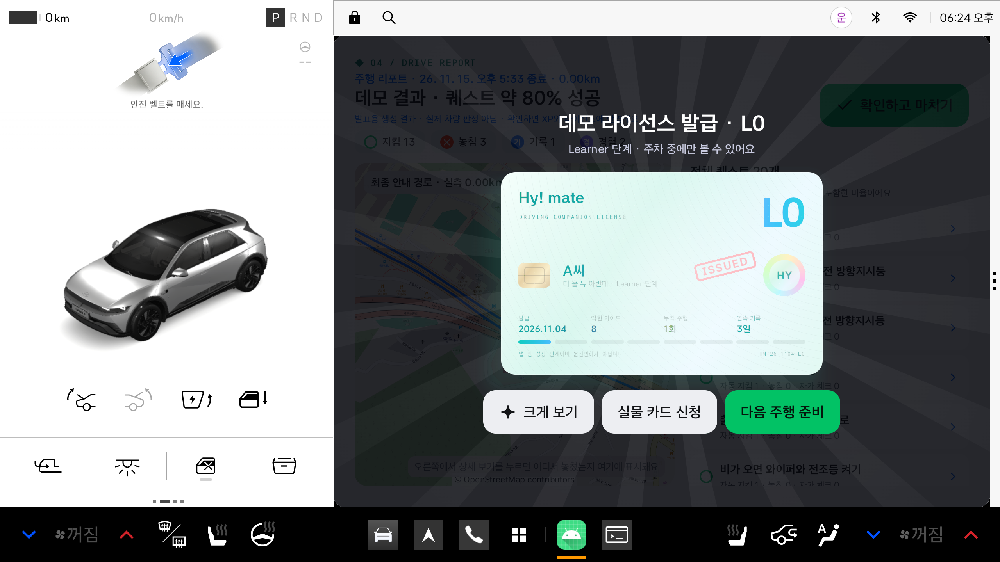
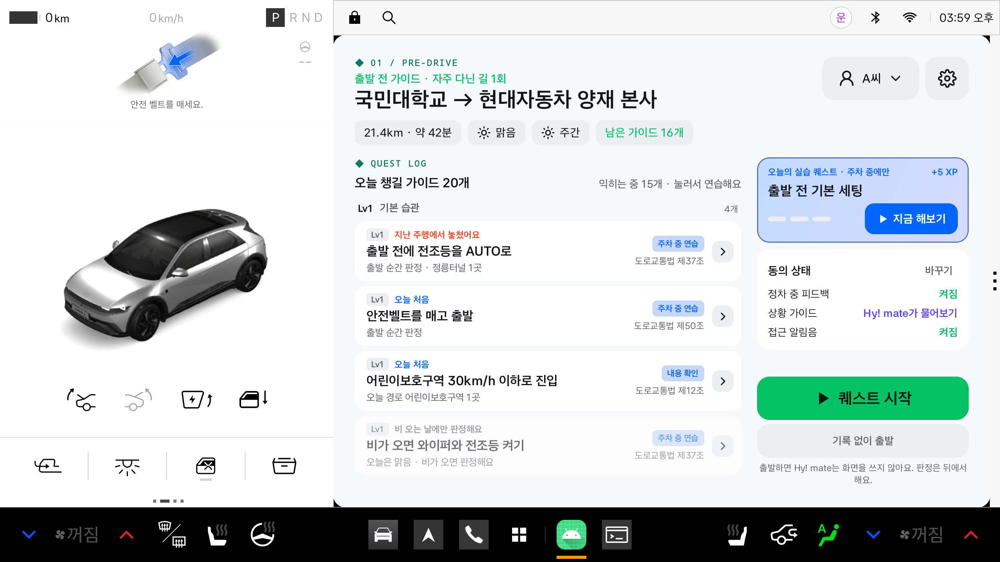
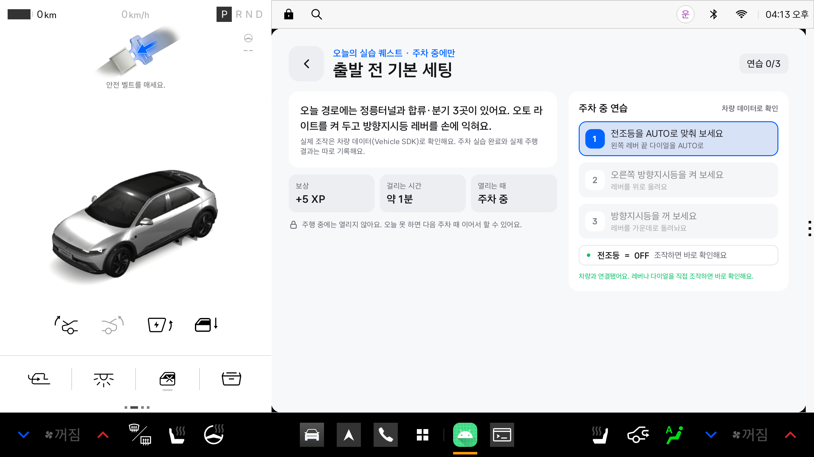
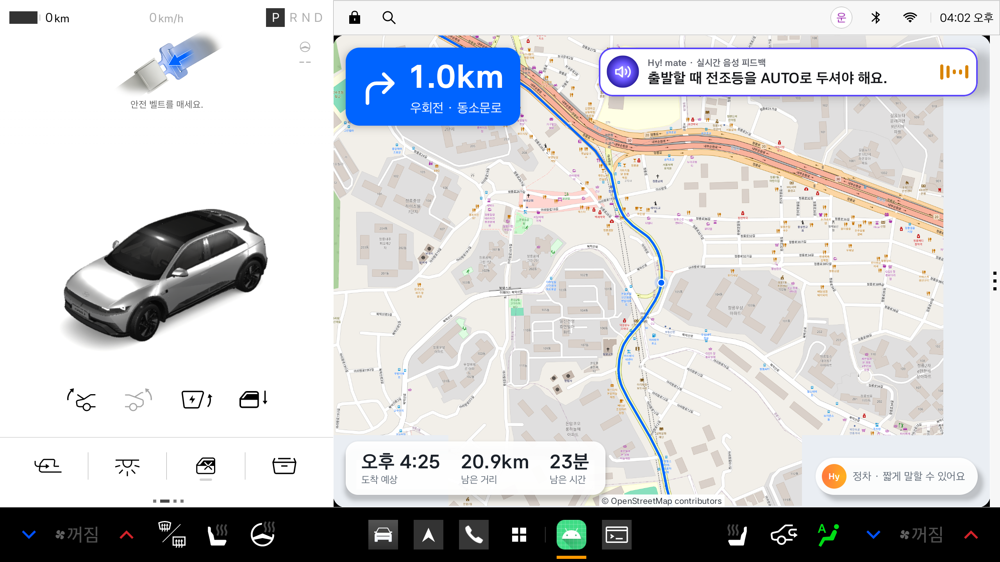
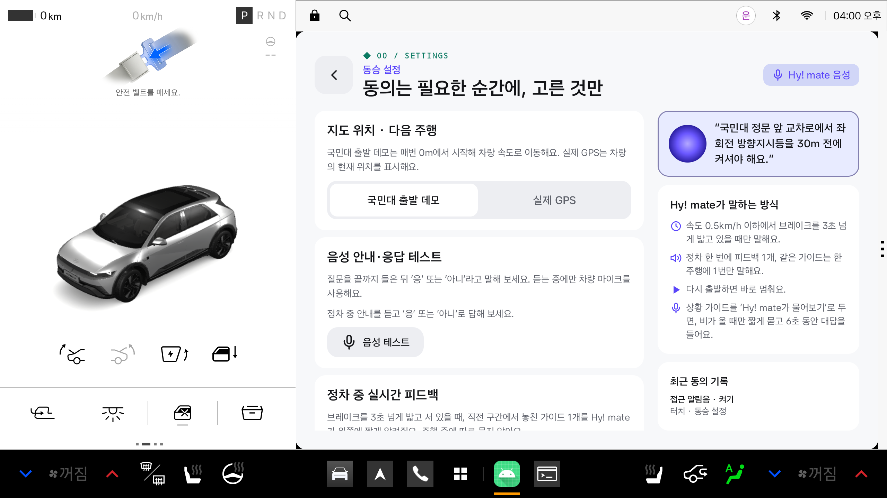
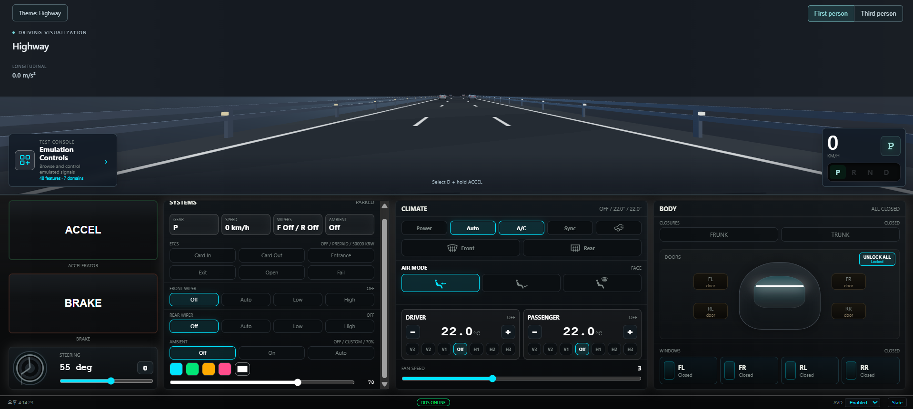
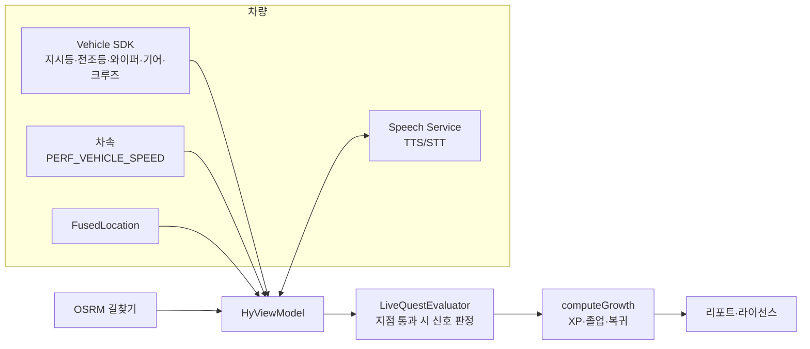

<h1 align="center">Hy! mate</h1>

<p align="center">
  혼자 타도 혼자가 아니게 — 차가 직접 가르쳐 주는 초보운전 동승 코치
</p>

<p align="center">
  
  
  
  
</p>

<p align="center">
  
</p>

## 소개

초보운전자가 기대는 건 조수석의 동승자다.

> "이따 우회전이야, 깜빡이 미리 켜자" · "방금 차선 변경 좋았어"

조언이 두려움을 덜고, 격려가 자신감이 된다. 문제는 혼자가 되는 순간 그 모든 게 사라진다는 것.
초행길과 고속도로를 피하게 되고, 운전을 마쳐도 뭘 잘했는지 뭘 놓쳤는지 알 수 없으니 경험이
자신감으로 쌓이지 않는다. 같은 실수를 반복하고, 두려워서 피하고, 그래서 경험을 쌓을 기회가
더 줄어드는 악순환.

기존 운전점수 앱은 스마트폰 GPS가 전부라 과속·급가속 정도만 본다. 방향지시등을 언제 켰는지,
와이퍼와 전조등을 챙겼는지는 모른다. **Hy! mate는 차량에 탑재되어 차량 데이터로 실제 조작을
직접 확인하고, 동승자의 조언과 격려를 대신한다.** 주행 중에는 아무것도 요구하지 않고 조용히
관찰만 하다가, 정차했을 때 한 마디, 주차한 뒤 리포트로 알려준다. 잘한 것은 게임처럼 쌓여
라이선스(L0 → L1 → …)로 성장한다.

<p align="center">
  
  <br/>
  <sub>첫 주행을 마치고 기준 XP를 넘기면 라이선스가 발급된다 — 익힌 가이드, 누적 주행, 연속 기록이 카드에 쌓인다</sub>
</p>

## 주요 기능

| 기능 | 설명 |
|---|---|
| 출발 전 학습 | 오늘 경로·날씨·내 기록으로 챙길 가이드를 선별하고, 주차 중에 레버·다이얼을 실제로 조작해 보며 익힌다 (Vehicle SDK로 즉시 확인) |
| 실도로 내비게이션 | OSRM 길찾기 + OpenStreetMap. 회전·합류 지점이 그대로 판정 지점이 된다 |
| 비간섭 주행 판정 | 방향지시등·전조등·차속 등 실제 차량 신호로만 판정. 주행 중 화면 조작·알림 없음 |
| 정차 중 음성 한 마디 | 완전히 멈췄을 때만(0.5km/h 이하 + 브레이크 3초) 놓친 가이드 1개를 짧게 (차량 TTS/STT) |
| 정직한 리포트 | 차가 확인 못 한 항목은 추측하지 않고 운전자에게 묻는다(자가 체크). 이의 제기 가능 |
| 성장과 라이선스 | 지킨 가이드는 XP로, 꾸준히 지키면 졸업. 누적되면 앱 안 라이선스가 승급 |
| 차종별 적응 | 차량 capability를 조회해 미지원 기능의 가이드는 자동 제외 |

<details>
<summary><b>설계 결정 — 왜 이렇게 만들었나</b></summary>

<br/>

**판정 지점을 미리 알려주지 않는다.** 알려주면 정답을 "따라 하게" 되어 몸에 익었는지
확인할 수 없다. 운전자가 평소처럼 운전하는 동안 학습한 내용을 스스로 적용하는지 본다.

**주행 중 앱은 침묵한다.** 주행 중 화면·음성 개입은 초보에게 가장 위험한 주의분산이다.
`distractionOptimized` 선언과 함께 시스템 CarUxRestrictions를 받아 설정·연습·리포트
화면을 스스로 잠근다.

**피드백은 기억이 생생할 때, 한 번에 하나.** 정차 피드백은 직전 구간에서 놓친 것 중
중요한 한 건만. 같은 가이드는 주행당 한 번, 차가 다시 움직이면 즉시 중단한다.

**추측하지 않는다.** 신호등 색처럼 차가 알 수 없는 건 실패로 만들지 않고 운전자에게
묻는다. 신호가 안 들어온 항목은 자동 판정 대신 자가 체크로 넘긴다. 상황마다 정답이
다른 행동(비보호 좌회전 등)은 평가 없이 기록만 한다.

**오판은 운전자가 바로잡는다.** 모든 판정에 근거를 붙이고, "이건 아니었어요" 한 번이면
해당 건은 성장 기록에서 빠진다. 코칭은 신뢰가 전제라서다.

**졸업하면 잔소리하지 않는다.** 기준을 채운 가이드는 출발 전 안내와 정차 피드백에서
빠진다. 판정은 계속하고, 다시 놓치기 시작하면 복습으로 돌아온다.

**내 차에 없는 기능은 안내하지 않는다.** 연결 시 capability를 조회해 미지원 가이드는
목록과 퀘스트에서 제외한다.

</details>

## 사용 흐름

1. **주차 중** — 오늘 가이드를 확인하고, 전조등 다이얼·방향지시등 레버를 직접 조작해 본다. 동의(피드백·상황 가이드)를 고른다.
2. **출발** — 현재 위치에서 목적지까지 실도로 경로를 탐색한다. 탐색된 회전·합류 지점이 판정 지점으로 등록된다.
3. **주행 중** — 앱은 아무것도 묻지 않는다. 차량 신호만 기록하고, 경로를 벗어나면 조용히 재탐색한다.
4. **정차** — 완전히 멈추면 놓친 가이드 하나를 음성으로 말해 준다. 출발하면 바로 끊는다.
5. **주차 후** — 리포트에서 판정 근거를 확인하고, 차가 못 본 항목에 직접 답하고, 쌓인 XP로 라이선스가 오른다.

## 화면

화면별 자세한 설명은 [docs/images/README.md](docs/images/README.md) 참고.

| 홈 | 출발 전 가이드 | 가이드 상세 |
|---|---|---|
|  |  |  |

| 주차 중 실습 | 주행 (실지도 안내) | 정차 중 음성 피드백 |
|---|---|---|
|  |  |  |

| 주행 리포트 | 리포트 상세 · 이의 제기 |
|---|---|
|  |  |

| 동승 설정 (동의·음성 테스트) | 테스트 환경 (Pleos Virtual Console) |
|---|---|
|  |  |

## 구조



차량 신호는 수신 전용이고 판정은 전부 온디바이스로 처리한다. 네트워크는 지도 타일과 길찾기에만 쓴다.

```
app/src/main/java/com/example/hymate/
├── data/         도메인 모델 · 가이드 정의 · 성장 규칙
├── navigation/   OSRM 길찾기 · 경로 투영 · 재탐색
├── speech/       차량 TTS/STT · 음성 동의 대화
├── vehicle/      차량 데이터 소스 · 주행 세션 · 퀘스트 판정
├── ui/           Compose 화면 · 실지도 컴포넌트 · 테마
├── HyViewModel.kt
└── MainActivity.kt
```

각 폴더에 상세 README가 있다. 판정·성장·경로·음성 동의 규칙은 `app/src/test`의 단위 테스트로 검증한다.

## 실행

**요구 사항**: Pleos Connect Emulator v2.1.0+ (일반 기기에서도 설치는 되지만 차량 신호 없이 UI만 동작), 인터넷(지도·길찾기)

```bash
git clone https://github.com/molba2see/Hymate.git
# Android Studio로 열고 Run
```

1. **Virtual Console**로 차량 신호를 조작한다 — `adb forward tcp:8088 tcp:8088` 후 `http://127.0.0.1:8088/` 접속. 기어·속도는 메인 패널, 방향지시등·전조등은 Emulation Controls > Convenience.
2. 위치 모드는 **동승 설정**에서 고른다.
   - `국민대 출발 데모` (에뮬레이터 기본): 위치 조작 없이 차속만으로 탐색된 실도로를 따라 이동
   - `실제 GPS` (실차 기본): 현재 위치 기준 탐색, 60m 이상 이탈 시 자동 재탐색
3. 지도·재탐색 테스트 시나리오: [docs/map-testing.md](docs/map-testing.md)

## 기술 스택

- **플랫폼** — Kotlin, Jetpack Compose, Android Automotive (minSdk 28 / targetSdk 34)
- **차량 연동** — Pleos Vehicle SDK 2.3.2, TextToSpeech·SpeechToText 3.3.1, FusedLocation 1.1.3, AAOS CarPropertyManager(차속)·CarUxRestrictions
- **지도·길찾기** — MapLibre Native, OpenStreetMap 래스터 타일, OSRM Route API, OkHttp
- **테스트** — JUnit4 로컬 단위 테스트

## 팀 국대오빠차

국민대학교 5인 팀.

| 이름 | 역할 |
|---|---|
| 김해나 | 기획 · PM |
| 송민승 | PO |
| [이상원](https://github.com/leesangwon393) | 기획 |
| 김정호 | 기획 · PM |
| [이은진](https://github.com/molba2see) | 앱 개발 (PA) |

## 외부 서비스 고지

지도 타일은 OpenStreetMap(© OpenStreetMap contributors), 길찾기는 OSRM 공개 데모 서버를 사용한다.
요청 간격 제한·식별 User-Agent·디스크 캐시로 사용 정책을 지키며, 상용 배포 시에는 상용 제공자로
교체가 필요하다.
