# 화면 안내

모든 스크린샷은 Pleos Connect Emulator(왼쪽: 차량 클러스터·차량 상태, 오른쪽: Hy! mate)에서 촬영했습니다.

---

## home.png — 홈

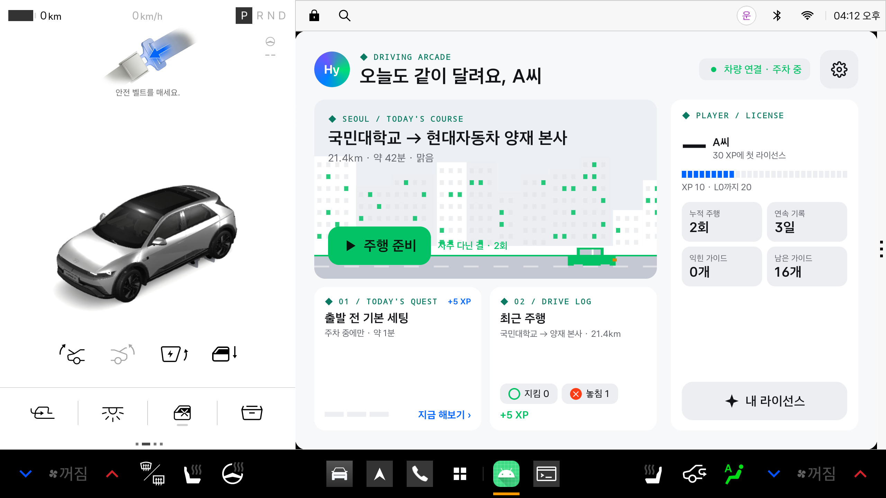

앱의 시작점. 운전자가 주차 중에 보는 첫 화면입니다.

- **오늘의 코스**: 목적지까지의 거리·예상 시간·날씨. 날씨는 서버 없이 와이퍼 작동 상태로 추정합니다(와이퍼가 움직이면 "우천 감지").
- **차량 연결 칩**(우상단): Vehicle SDK 연결 상태와 주차/주행 여부. 차량이 아니면 "시뮬레이션"으로 표시됩니다.
- **오늘의 실습 퀘스트 / 최근 주행**: 주차 중 1분 실습 입구와 직전 주행 요약(지킴·놓침·획득 XP).
- **PLAYER / LICENSE**: 누적 XP 게이지와 다음 라이선스까지 남은 양, 누적 주행·연속 기록·익힌 가이드 수.

## pre-drive.png — 출발 전

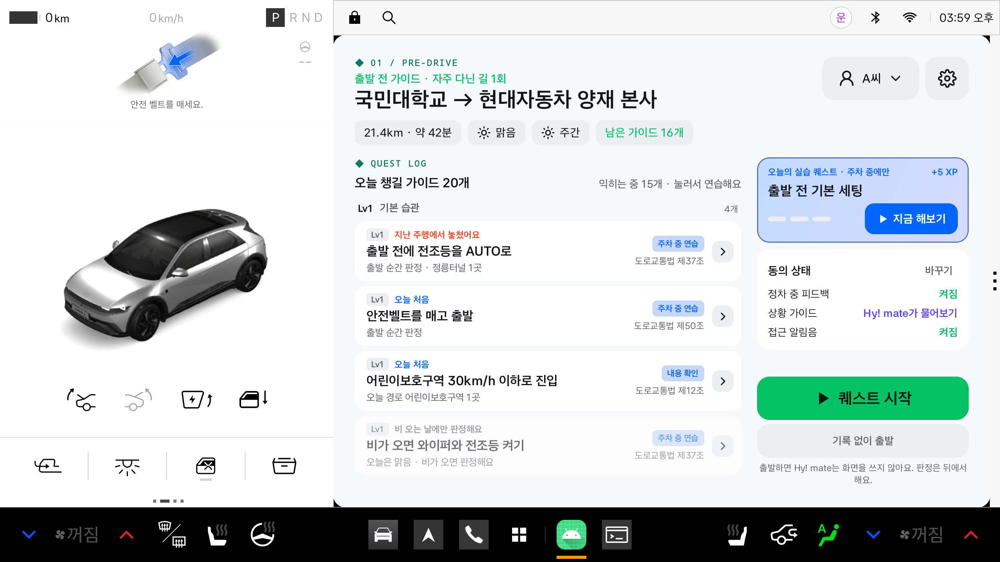

주행 준비 화면. 오늘 챙길 가이드를 레벨별로 보여줍니다.

- 각 가이드에는 **상태 태그**가 붙습니다 — "지난 주행에서 놓쳤어요"(빨강), "오늘 처음", "비 오는 날에만 판정해요" 등. 내 기록에 따라 정렬이 달라집니다.
- 근거 법령(도로교통법 조항)을 함께 표기해 왜 지켜야 하는지 보여줍니다.
- 졸업한 가이드는 목록 하단에 접혀 들어가고, 차량이 지원하지 않는 기능의 가이드는 아예 나타나지 않습니다.
- **동의 상태** 카드: 정차 중 피드백·상황 가이드·접근 알림음의 현재 동의 값. "퀘스트 시작"을 눌렀을 때만 판정·기록합니다.

## guide-detail.png — 가이드 상세

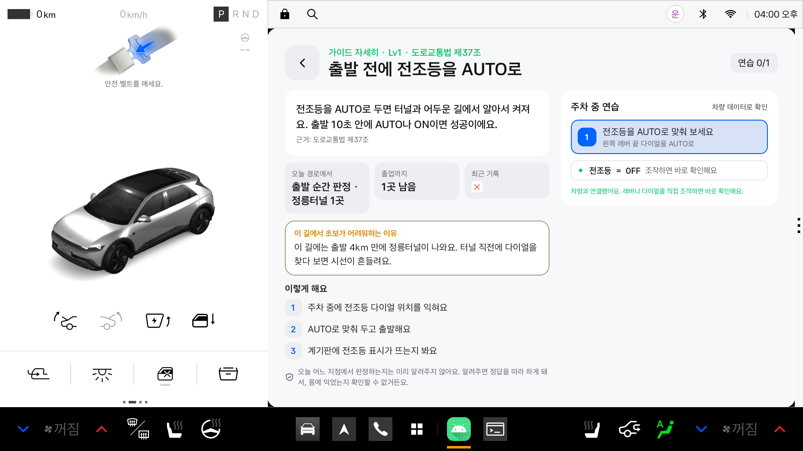

가이드 하나를 깊게 배우는 화면 (예: "출발 전에 전조등을 AUTO로").

- 판정 기준("출발 10초 안에 AUTO나 ON이면 성공"), 오늘 경로에서 판정되는 지점 수, 졸업까지 남은 횟수, 최근 기록.
- **이 길에서 초보가 어려워하는 이유**: 경로 맥락과 연결된 설명 (출발 4km 만에 정릉터널).
- **주차 중 연습**(오른쪽): 실제 레버·다이얼을 조작하면 Vehicle SDK로 즉시 확인됩니다. 아래 녹색 문구("차량과 연결됐어요")가 실연동 상태를 알려줍니다.
- 판정 지점을 미리 알려주지 않는 이유를 화면 하단에 명시합니다 — 알려주면 정답을 따라 하게 되어 몸에 익었는지 확인할 수 없기 때문입니다.

## practice.png — 오늘의 실습 퀘스트

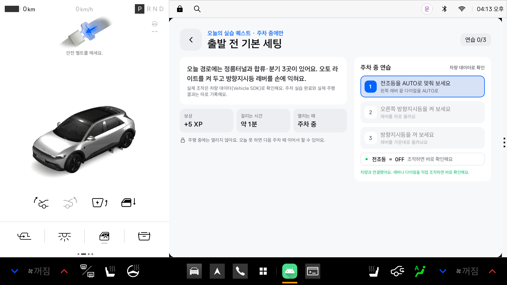

출발 전 1분 실습 묶음("출발 전 기본 세팅"). 오늘 경로에 터널·합류가 있으니 오토 라이트와 방향지시등 레버를 미리 손에 익히자는 구성입니다.

- 단계별 체크리스트(전조등 AUTO → 오른쪽 지시등 켜기 → 끄기)가 **실제 차량 조작**으로 하나씩 완료됩니다.
- 주행 중에는 열리지 않고, 오늘 못 하면 다음 주차 때 이어서 할 수 있습니다.

## drive-nav.png — 주행 (실도로 내비게이션)

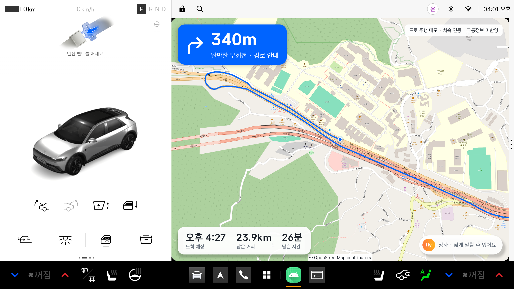

주행 화면. OpenStreetMap 지도 위에 OSRM으로 탐색된 실제 자동차 경로(파란 선)와 차량 위치를 표시합니다.

- 좌상단 **TBT 카드**: 다음 회전까지 거리와 안내("340m 완만한 우회전"). 탐색 응답의 회전 지점에서 만들어지며, 이 지점들이 그대로 방향지시등·회전 속도 판정 지점이 됩니다.
- 하단 **도착 카드**: 도착 예정 시각·남은 거리·남은 시간. OSRM 구간별 예상 시간으로 계산합니다.
- 우하단 **상태 알약**: "정차 · 짧게 말할 수 있어요" — Hy! mate가 화면을 쓰지 않고 뒤에서 기록 중임을 알리는 최소한의 표시입니다.
- 우상단 작은 배지: 데모 모드임을 표기("도로 주행 데모 · 차속 연동 · 교통정보 미반영").

## drive-voice.png — 정차 중 음성 피드백

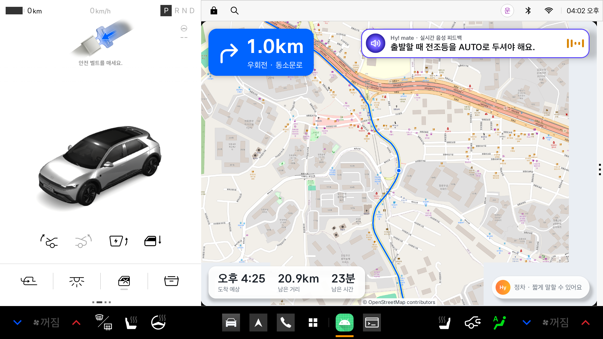

정차 판정(속도 0.5km/h 이하 + 브레이크 3초)이 성립했을 때만 나타나는 음성 피드백 배너.

- 직전 구간에서 놓친 가이드 **1개만** 짧게 말합니다("출발할 때 전조등을 AUTO로 두셔야 해요"). 차량 TTS로 재생되며 화면 배너는 보조 표시입니다.
- 같은 가이드는 한 주행에 한 번만, 다시 출발하면 즉시 중단됩니다.

## settings.png — 동승 설정

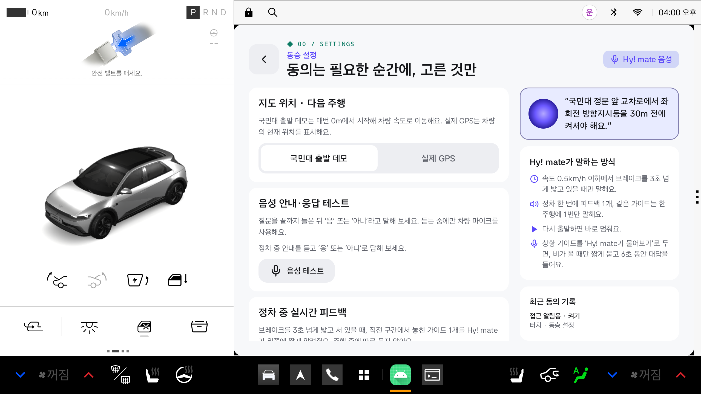

동의와 테스트를 모아 둔 화면. "동의는 필요한 순간에, 고른 것만"이 원칙입니다.

- **지도 위치 · 다음 주행**: `국민대 출발 데모`(위치 조작 없이 차속만으로 탐색 경로를 따라 이동) ↔ `실제 GPS`(현재 위치 기준 탐색·자동 재탐색) 전환.
- **음성 안내·응답 테스트**: 주차 중에 TTS 질문 → "응/아니" 음성 응답까지 왕복으로 점검. 듣는 중에만 차량 마이크를 사용합니다.
- **Hy! mate가 말하는 방식**: 언제 말하고 언제 멈추는지 규칙을 투명하게 공개.
- **최근 동의 기록**: 무엇에·언제·어떤 채널(터치/음성)로 동의했는지 이력.

## report.png — 주행 리포트

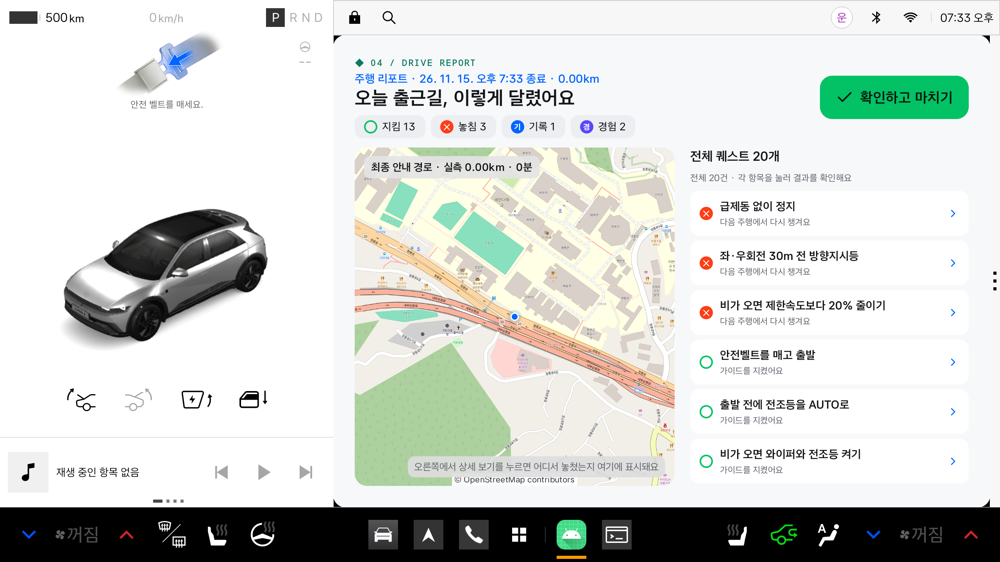

주차 후 보는 결과 화면. 지킴·놓침·기록·경험 개수와 전체 퀘스트 목록.

- 놓친 항목이 위로 정렬되고, "다음 주행에서 다시 챙겨요"로 이어집니다.
- 지도에는 최종 안내 경로와 기록 지점이 표시됩니다.
- 신호 미수신으로 판정하지 못한 항목은 실패로 추측하지 않고 "직접 체크"로 넘어갑니다.

## report-detail.png — 리포트 상세 · 이의 제기

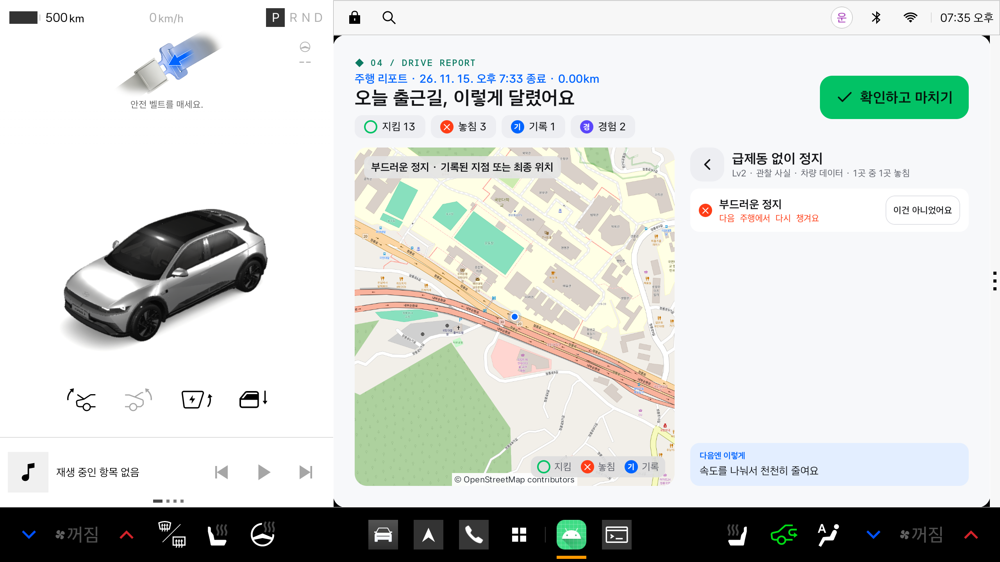

퀘스트 하나를 눌렀을 때의 상세. 어떤 근거로 판정했는지와 지점별 결과를 보여줍니다.

- **"이건 아니었어요"** 버튼: 운전자가 판정에 이의를 제기하면 해당 놓침은 성장 계산에서 제외됩니다. 차를 믿되, 최종 판단은 운전자에게.
- **다음엔 이렇게**: 짧은 교정 팁 한 줄.

## license.png — 라이선스 발급

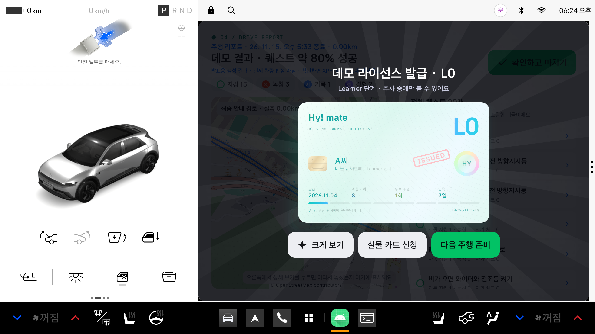

첫 주행을 마치고 XP가 기준을 넘으면 라이선스가 발급되는 연출 화면.

- 카드에는 발급일·익힌 가이드·누적 주행·연속 기록이 담깁니다.
- "앱 안 성장 단계이며 운전면허가 아닙니다"를 카드에 명시합니다. 주차 중에만 볼 수 있습니다.

## virtual-console.png — 테스트 환경

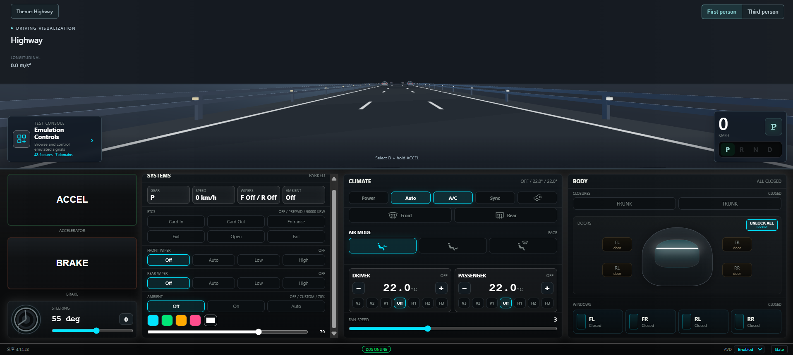

Pleos Connect Emulator의 Virtual Console. 기어·속도·와이퍼·방향지시등(Convenience 도메인) 등 차량 신호를 손으로 조작하면 앱이 실시간으로 반응하는 것을 검증할 때 사용합니다. 자세한 시나리오는 [`../map-testing.md`](../map-testing.md) 참고.
